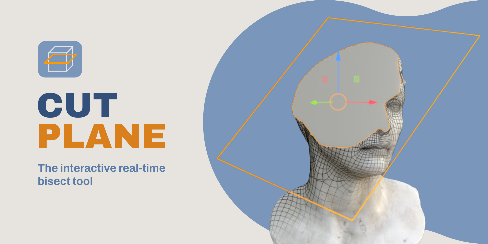
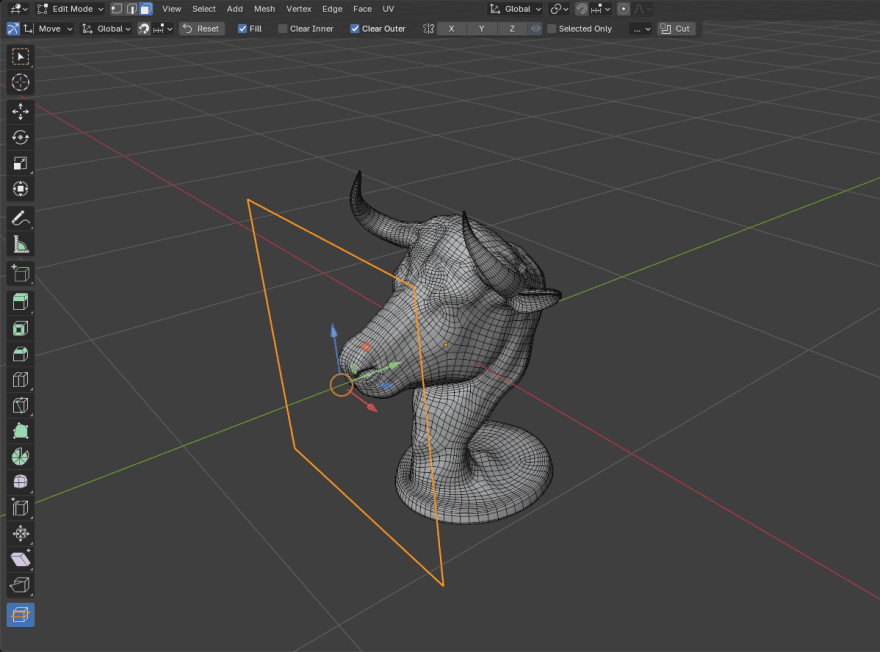
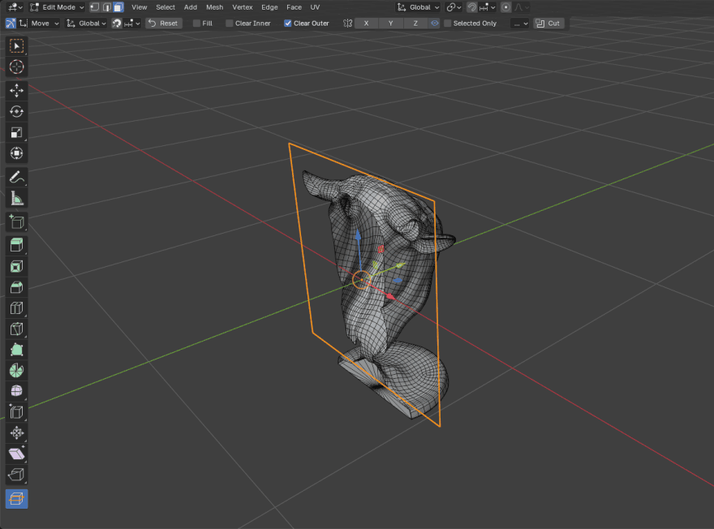
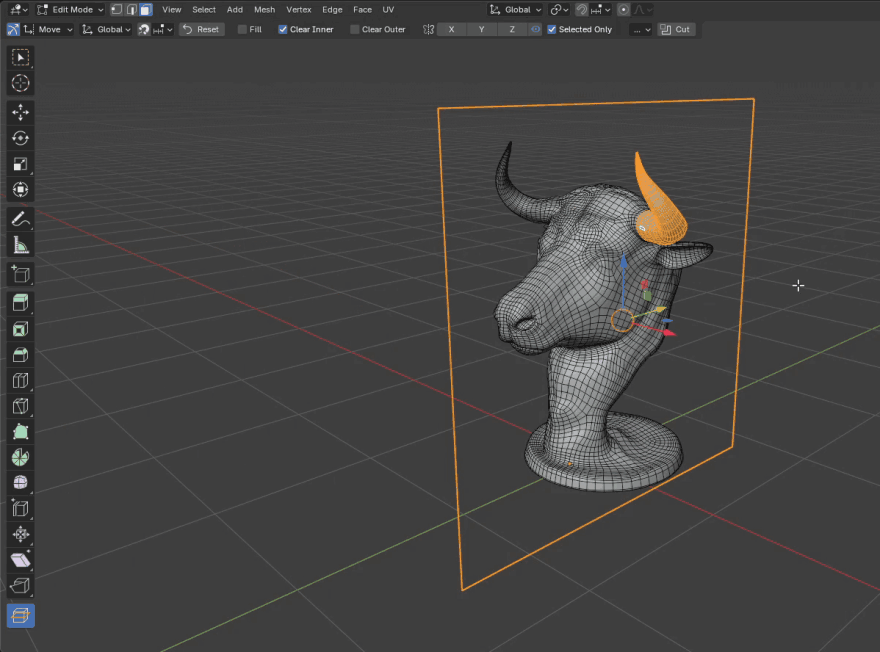
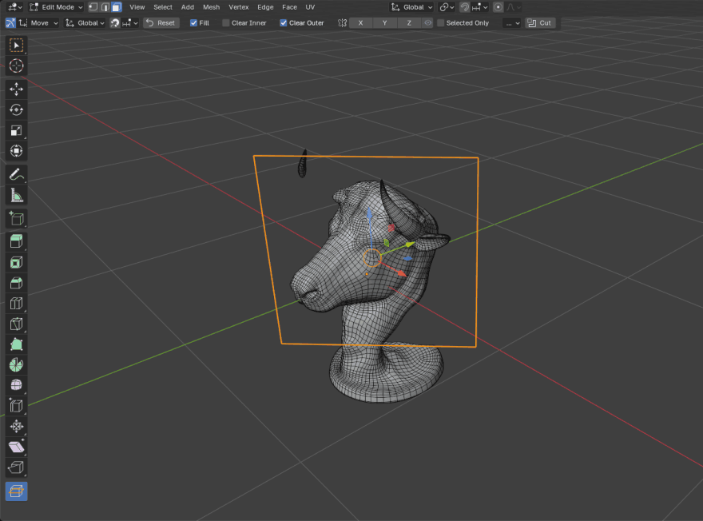
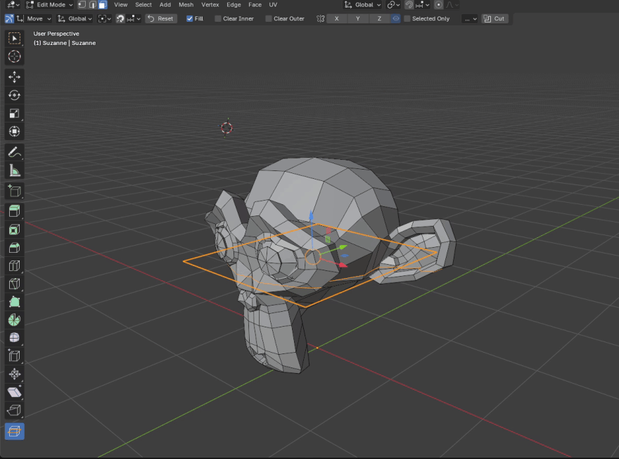
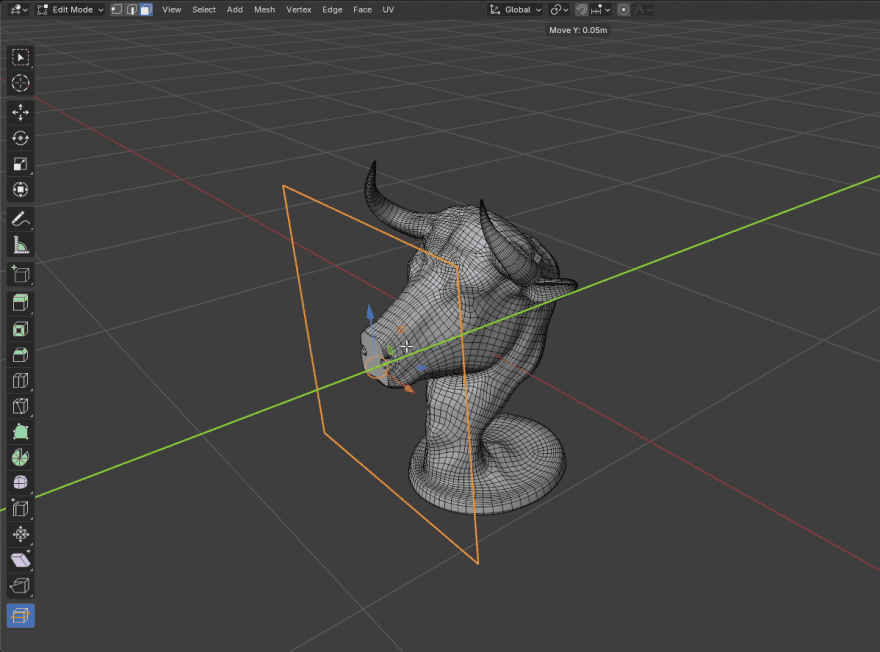

# Cut Plane



[](https://github.com/firg659-del/cut-plane/actions/workflows/tests.yml)


A Blender Edit Mode tool. Position a plane with a gizmo; the mesh is bisected
along it and redrawn on every change. `Enter` commits the cut.

Requires Blender 4.5 or newer.

---

## Live preview



The preview is a real bisect of the mesh, not an approximation. Move or rotate
the plane and the cut is recomputed. The original is restored when you leave
the tool, switch tools, save, or leave Edit Mode.

Gizmo modes: move arrows, three rotation dials plus a view dial and trackball,
and scale handles. `G` / `R` / `S` work as they do elsewhere in Blender.

## Cut options



**Fill** caps the cross-section. **Clear Inner** and **Clear Outer** delete one
side. Each re-cuts immediately.

## Selected Only



Restricts the cut to selected geometry. Above, the plane crosses the whole
bust and only the selected horn is cut.

## Mirror



**Mirror X / Y / Z** cut with mirrored copies of the plane - one plane becomes
two, four or eight. They reflect through the **Anchor**, below. Grey ghost
planes show where the mirrored cuts land; the eye icon hides them.

A mirror that reflects the plane onto itself adds no cut, and the header names
which axis. A fresh plane starts on the Anchor, so nothing is mirrored until
you move it off.

## Anchor



One point decides where a fresh plane lands and what the mirrors reflect
through. **Bounding Box** is the middle of the mesh, so the plane starts on the
geometry - an object origin can sit far outside it. **Object Origin** and **3D
Cursor** put that point where you want it instead; move the cursor and the
mirrored cuts follow.

**Reset** re-centres the plane on the current Anchor. With several objects in
Edit Mode the Anchor is read from the active one, so every object is cut by the
same planes.

## Numeric input

![A rotation started by hand, then 90 typed: the header reads Rotate View [90] and the plane swings to exactly ninety degrees](docs/images/type-in.gif)

Type a value during any transform. The header shows the buffer and the plane
jumps to it. Scene units parse - `0.5m`, `25cm`, degrees for angles.

## Snapping



`X` / `Y` / `Z` during a drag locks the plane to an axis; the header shows the
distance. The magnet snaps to vertices, edge centres, faces or the grid. Snap
targets are ray-cast against the original mesh, so they stay put where the
preview has already cut geometry away.

<sub>Model: <a href="https://polyhaven.com/a/bull_head">Bull Head</a> from Poly Haven (CC0).</sub>

---

## Install

Download `cut_plane-1.1.0.zip` from the
[latest release](https://github.com/firg659-del/cut-plane/releases) and drag it
into Blender, or use **Edit → Preferences → Get Extensions → Install from
Disk…**

## Usage

Enter Edit Mode and pick **Cut Plane** from the toolbar (`T` if it is hidden).
It is also in the **Mesh** menu and in `F3` search.

The plane appears at the mesh centre, already previewing. Position it, set the
options in the header row, press `Enter`.

The tool stays active after a cut, so you can move the plane and cut again -
each cut applies to the result of the last one, and each is its own undo step.

| Keys | Action |
|---|---|
| `G` / `R` / `S` | Move / rotate / scale the plane |
| `R`, `R` | Trackball rotation |
| `X` `Y` `Z` during a drag | Constrain to an axis |
| numbers during a drag | Exact value, with units |
| `Shift` / `Ctrl` during a drag | Precision / snapping |
| `Alt+G` / `Alt+R` / `Alt+S` | Clear location / rotation / scale |
| `Esc` / right-click | Cancel the drag |
| `Enter` | Commit the cut |
| `Ctrl+Z` | Undo - plane moves first, then cuts |

Cmd replaces Ctrl on macOS. Shortcuts are rebindable in **Preferences →
Add-ons → Cut Plane**.

Full guide, including Align Rotation and the known limitations:
[DOCUMENTATION.md](cut_plane/DOCUMENTATION.md).

## Support

Bug reports and questions: **firgcg@gmail.com** - include your Blender
version and, where possible, the .blend file. Issues and pull requests:
[GitHub](https://github.com/firg659-del/cut-plane/issues).

[GPL-3.0-or-later](cut_plane/LICENSE).

---

<details>
<summary><b>For developers</b></summary>

### Running from source

Open `dev_load.py` in Blender's text editor and press **Run Script**. Re-run
after each edit; it reloads cleanly.

```
python -m ruff check cut_plane
python -m pytest
```

The suites under `tests/` run headless against Blender 4.5 and 5.1 in CI -
see `.github/workflows/tests.yml`.

### Building

```
blender --command extension build --source-dir cut_plane --output-dir dist
```

Extensions only - there is no `bl_info`; `blender_manifest.toml` is the single
metadata source.

### Source layout

```
cut_plane/                 The addon package (this is what ships)
├── __init__.py              register()/unregister()
├── blender_manifest.toml    Extension metadata (the single metadata source)
├── LICENSE                  GPL-3.0-or-later license text
├── DOCUMENTATION.md         User guide (ships in the zip)
├── CHANGELOG.md             User-facing release notes (ships in the zip)
├── cutting/                 Live-cut engine (one module per concern)
│   ├── state.py               Session registry + shared latches
│   ├── plane.py               Plane pose, local transform, mirror expansion
│   ├── snapshot.py            Take / validate / rebuild-from the original
│   ├── invariants.py          Self-instrumentation over the session state
│   ├── snap_support.py        Snapshot BVH + baseline queries
│   ├── selection.py           Remap / clear / reselect / repair semantics
│   ├── preview.py             Per-frame apply orchestrator + restore
│   ├── watchdog.py            Tool-active watchdog + deferred sync
│   └── handlers.py            Save/load/undo handlers, purge, crash recovery
├── operators/
│   ├── utils.py               Re-entry guard shared by modal operators
│   ├── numeric_input.py       Numeric type-in state machine + unit parsing
│   ├── rotate.py              Axis / view / trackball rotation
│   ├── move.py                Axis arrows + free-move center button
│   └── scale.py               Plane / axis / uniform scale
├── ui/
│   ├── drawing.py             GPU drawing (plane, rotation arc, snap ticks)
│   ├── gizmos.py              CutPlaneVisual + CutPlaneGroup
│   └── tool.py                Workspace tool + tool settings (header row)
├── lib/
│   ├── constants.py           Tuning constants and module-load caches
│   ├── math_utils.py          Math / context helpers
│   └── handler_store.py       Draw-handler handle store (file-load-proof)
└── state/
    ├── properties.py          Tool-state groups (WindowManager) + depsgraph handler
    ├── persistence.py         .blend save/load for the WM tool state
    ├── preferences.py         Addon preferences
    └── pose_history.py        Tool-scoped pose undo history
```

</details>
